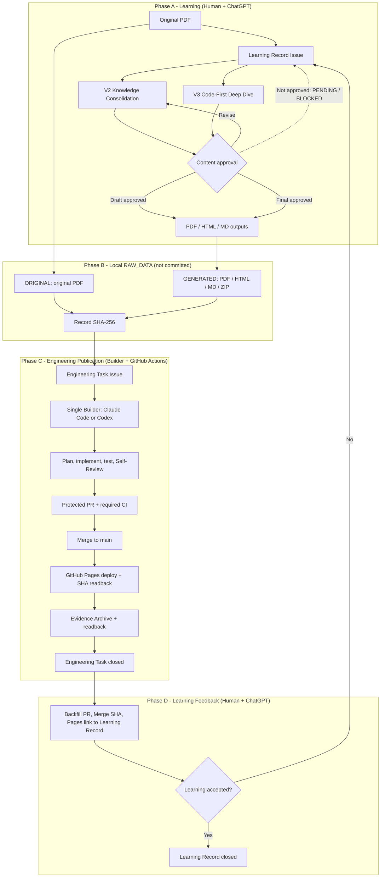
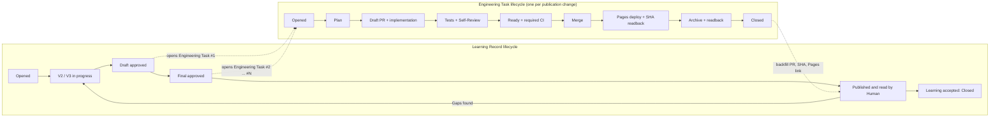

# myaiwouldbemine Copy Learning Hub

**A Multi-Disciplinary, Code-First, Evidence-Driven Learning Platform**

多學科、程式碼優先、證據導向的個人學習與知識管理平台。

## 1. Project Overview｜專案簡介

Copy Learning Hub 旨在將大學課程講義、技術文件、原始碼、數學公式及實作結果整理為可長期維護的線上學習教材。

主要學習流程：

**Source Materials → Deep Understanding → Code / Formula → Verification → Documentation → Web Publishing**

核心原則：

- **Code-First**：盡可能透過實際程式碼解釋理論。
- **Evidence-Driven**：重要結論必須具備可追溯的來源或驗證紀錄。
- **Page-by-Page Learning**：依原始教材頁碼逐頁深入學習。
- **Progressive Validation**：透過理解驗收與實作確認學習成果。
- **Reusable Knowledge**：將學習成果整理成可重複閱讀的文件。
- **Single-Builder**：Claude Code 或 Codex 擔任唯一工程 Builder；ChatGPT＋Human 保有教材所有權。

## 2. Learning Subjects｜學科分類

| Subject | Coverage |
|---|---|
| Operating Systems | NYCU OS, NachOS, Linux, Scheduling, Memory, File Systems |
| Machine Learning | Regression, Classification, Model Evaluation |
| Deep Learning | Neural Networks, Backpropagation, Optimization, PyTorch |
| Computer Vision | CNN, ResNet, Object Detection, Vision Transformers |
| Natural Language Processing | Tokenization, Embeddings, Attention, Transformers, LLM |

未來可新增其他學科，而不需要重新設計平台架構。

## 3. Technology Stack｜技術架構

| Component | Technology |
|---|---|
| Learning Content | Markdown |
| Static Website | MkDocs Material |
| Code Highlighting | Pygments / Markdown Extensions |
| Diagrams | Mermaid |
| Mathematics | MathJax |
| Version Control | Git / GitHub |
| CI/CD | GitHub Actions |
| Hosting | GitHub Pages |
| Future Interactive Labs | Streamlit / Python |
| Agent Collaboration | Claude Code / Codex |

目前採用 MkDocs Material 建立網站，未來可另行評估 Zensical 遷移。

## 4. Repository Structure｜專案結構

```text
myaiwouldbemine-Copy-Learning-Hub/
├── .github/
│   ├── PULL_REQUEST_TEMPLATE.md
│   └── workflows/
│       ├── docs-check.yml
│       └── pages.yml
├── RAW_DATA/                      # local-only; only README.md is tracked
├── RELEARNING_SUPPLEMENTS/
├── records/
│   └── ISSUE-<number>/            # PLAN.md / RESULT.md
├── docs/
│   ├── index.md
│   ├── subjects/
│   │   ├── operating-systems/
│   │   ├── machine-learning/
│   │   ├── deep-learning/
│   │   ├── computer-vision/
│   │   └── Natural-Language-Processing/
│   └── assets/
├── AGENTS.md
├── GOVERNANCE.md
├── INSTALL.md
├── mkdocs.yml
├── requirements.txt
└── README.md
```

部分 CI/CD 與學習內容仍屬規劃中，實際目錄以目前 Repository 為準。

## 5. Local Development｜本機開發

### Requirements

- Python 3.12+
- Git
- VS Code（建議）
- WSL Ubuntu（建議）

### Installation

```bash
git clone https://github.com/myaiwouldbemine/myaiwouldbemine-Copy-Learning-Hub.git
cd myaiwouldbemine-Copy-Learning-Hub

python3 -m venv .venv
source .venv/bin/activate

python -m pip install -r requirements.txt
```

### Local Preview

```bash
mkdocs serve
```

開啟：

http://127.0.0.1:8000/

### Build Validation

```bash
mkdocs build --strict
```

本機建置成功只代表網站能夠產生，不代表所有教材內容均已完成技術或教學驗收。

## 6. Learning Content Standards｜教材規範

每個完整的學習單元可包含：

- `README.md`：完整學習筆記。
- `EVIDENCE.md`：原始資料、程式碼與驗證證據。
- `TERMINOLOGY.md`：中英文專業術語。
- `CODE_WALKTHROUGH.md`：必要的程式碼分析。
- `FORMULAS.md`：必要的公式推導。
- `assets/`：圖片與教學圖表。

各學科可以採用專屬教學規範，但共用一致的文件與出版原則。

### Operating Systems

使用 **NYCU OS Learning Framework v3.1 OS Edition**。

重點包括：

- PDF 逐頁深入解說。
- NachOS / Linux 原始碼對照。
- MIPS Assembly。
- VS Code Code Walkthrough。
- Execution Flow / State Trace。
- 理解驗收與證據文件化。

<a id="learning-to-publishing-workflow"></a>

## 7. Learning-to-Publishing Workflow｜教材製作與發布流程

本流程把「學習與教材語義」和「工程發布」分成兩條獨立軌道：ChatGPT＋Human 決定教材內容是否正確、是否核准；唯一 Builder 只負責忠實匯入、測試與發布。Draft 可以先發布，未完成驗收的內容保持 PENDING。

### 7.1 Phases｜階段

| Phase | 名稱 | 步驟 | 負責 |
|---|---|---|---|
| A | Learning | 取得 Original PDF → 開立 Learning Record → 製作 V2（Knowledge Consolidation）與 V3（Code-First Deep Dive）→ Draft／Final 內容核准，未通過則循環修訂 | Human＋ChatGPT |
| B | Local RAW_DATA | 原始 PDF 存入 `ORIGINAL/`，核准產出的 PDF／HTML／MD／ZIP 存入 `GENERATED/`，記錄 SHA-256；僅存本機，不進 Git | Human |
| C | Engineering Publication | 開立 Engineering Task → 唯一 Builder 規劃、實作、測試、自審 → Protected PR → CI → Merge → Pages 部署與 SHA 讀回 → Evidence Archive → 工程結案 | Builder＋GitHub Actions |
| D | Learning Feedback | 將 PR、Merge SHA、Pages 連結回填 Learning Record，Human 閱讀並驗收；未達標則回到 Phase A 並開新 Engineering Task | Human＋ChatGPT |

### 7.2 Workflow Diagram｜流程圖



### 7.3 Role Matrix｜角色責任矩陣

| 責任 | Human | ChatGPT | Builder（Claude Code 或 Codex，唯一） | GitHub Actions |
|---|---|---|---|---|
| 開立 Learning Record | ✅ 負責 | 協助 | — | — |
| V2／V3 創作、推導、語義品質 | ✅ 核准 | ✅ 製作 | ❌ 不得創作 | — |
| 教材語義核准（Draft／Final） | ✅ 與 ChatGPT 共同 | ✅ 與 Human 共同 | ❌ 不得代為核准 | ❌ |
| 原始資料保存、SHA-256、授權 | ✅ 負責 | 協助記錄 | 僅讀取、核對 | — |
| 開立 Engineering Task、啟動 Builder | ✅ 負責 | 協助撰寫 | — | — |
| 規劃、實作、測試、自審 | 可修改需求或停止 | — | ✅ 負責 | — |
| 忠實匯入已核准教材 | — | — | ✅ 不改語義；未核准標記 PENDING／BLOCKED | — |
| 必要 CI 檢查 | — | — | 修正失敗 | ✅ 執行並回報 |
| Merge、Pages、SHA 讀回 | — | — | ✅ 自主執行並核對 | ✅ 部署 |
| Evidence Archive、工程結案 | — | — | ✅ 負責 | 輔助 |
| 學習驗收與 Learning Record 結案 | ✅ 負責 | 協助 | ❌ 不得結案 | ❌ |

CI PASS、Merge、部署成功或 Engineering Task 結案，都不代表教材品質核准或學習掌握。Self-Review、CI、Bot Summary 與 Human 意見不得互相冒充。

### 7.4 Issue Lifecycles｜兩種 Issue 生命週期



- 一個 Learning Record 可以連結多次 Engineering Task，例如 Draft 發布、Final 發布、勘誤修正。
- 兩者**獨立結案**：Engineering Task 在 Merge、部署驗證與證據歸檔讀回後結案；Learning Record 只在 Human 驗收學習成果後結案。
- 工程結案 ≠ 學習完成；Learning Record 可以在多個 Engineering Task 結案後仍保持 Open。
- Learning Record 以留言逐步更新，不必對應 PR；只有 Repository 變更才進入 Engineering Task。

### 7.5 Case Study｜LEC08 範例

NYCU OS LEC08（Memory Management）：[Learning Record #26](https://github.com/myaiwouldbemine/myaiwouldbemine-Copy-Learning-Hub/issues/26)、Draft 發布的 [Engineering Task #24](https://github.com/myaiwouldbemine/myaiwouldbemine-Copy-Learning-Hub/issues/24)、[PR #25](https://github.com/myaiwouldbemine/myaiwouldbemine-Copy-Learning-Hub/pull/25)。本機檔案為 `RAW_DATA/operating-systems/LEC08/ORIGINAL/lec08.pdf` 與 `RAW_DATA/operating-systems/LEC08/GENERATED/LEC08_FULL_DRAFT.zip`，不提交至 Git。Draft 發布不代表內容已核准，教材驗收仍為 PENDING。

### 7.6 Where Things Live｜資料存放分工

| 位置 | 用途 | 進入 Git |
|---|---|---|
| `RAW_DATA/` | 本機原始與產出檔（見 [RAW_DATA/README.md](RAW_DATA/README.md)） | 僅 README |
| `docs/` | 已核准或標示 Draft 的網站教材 | 是 |
| `RELEARNING_SUPPLEMENTS/` | 依 Issue 的重學清單 | 是 |
| `records/ISSUE-<number>/` | 工程 Plan 與 Result 證據 | 是 |

## 8. On-Demand Autonomous Engineering｜按需自主工程

Human 建立工程 Issue，並在需要時啟動 Codex App／本機 Agent，定義 WHAT／WHY／DONE／邊界。唯一 accountable Builder（Codex 或 Claude Code）自主規劃、實作、測試、自審、維護 PR、Ready、Merge、適用部署、Evidence 歸檔與結案；不使用 L0–L3 或重複 Human 工程核准。

ChatGPT＋Human 保有 V2 Knowledge Consolidation／V3 Code-First Deep Dive 的創作、推導、語義品質、核准與最終整合。製作時分開、定稿時合併、網站依主題呈現。工程 Agent 只忠實匯入已核准教材；缺少語義核准時標記 PENDING／BLOCKED。

在 GitHub New Issue 選擇 Learning Record，以留言逐步補上 V2／V3 里程碑、來源、品質證據與定稿連結。需要變更 Repository 時選擇 Engineering Task。MkDocs 提供依主題閱讀、搜尋與導覽。

所有變更透過 PR；必要 Plan 先於實作提交，有 Plan 就有 Result。必要 CI、自審與目前 head／base 證據完整後才能自主 Merge，不直接 push main、force push 或繞過保護。Self-Review 不冒充獨立人工審查。

完整教材製作與發布順序見 [Learning-to-Publishing Workflow](#learning-to-publishing-workflow)。

參閱 [GOVERNANCE.md](GOVERNANCE.md)、[完整雙語 AGENTS.md](AGENTS.md)、[安裝說明](INSTALL.md)。

## 9. Deployment｜網站部署

受保護 PR 合併至 main 時，push 會自動觸發 GitHub Pages 工作流程。流程執行 strict MkDocs、部署網站並透過 HTTPS 讀回 deployment-sha.txt。Builder 核對發布 SHA 與 Merge SHA，歸檔並讀回證據後結案。

## 10. Project Status｜目前進度

按需工程與自動 Pages 的實作及驗收紀錄見 [Issue #20](https://github.com/myaiwouldbemine/myaiwouldbemine-Copy-Learning-Hub/issues/20) 與 [Issue #22](https://github.com/myaiwouldbemine/myaiwouldbemine-Copy-Learning-Hub/issues/22)。

## 11. Roadmap｜未來發展

**Phase 1 — Documentation Portal**

建立穩定的多學科 Markdown 學習網站。

**Phase 2 — Learning Content Integration**

匯入 OS、ML、DL、CV、NLP 的正式學習教材。

**Phase 3 — Interactive Learning Labs**

建立 Streamlit / Python 互動模擬器與練習工具。

**Phase 4 — Personal Learning System**

加入學習進度、錯題複習、知識關聯及跨裝置同步。

---

**Project:** myaiwouldbemine Copy Learning Hub
**Repository:** https://github.com/myaiwouldbemine/myaiwouldbemine-Copy-Learning-Hub
**Development Policy:** Pull Request First
**Learning Philosophy:** Code-First · Evidence-Driven · Deep Understanding
